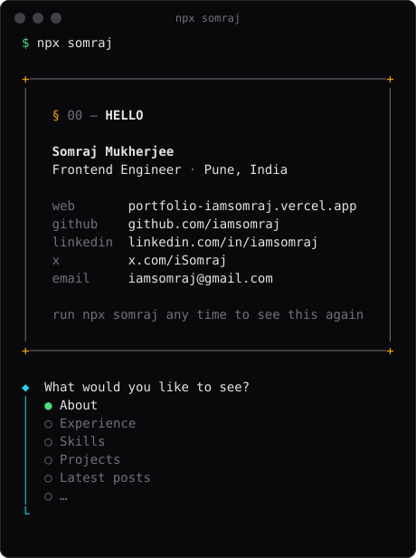

# somraj

[](https://www.npmjs.com/package/somraj)
[](https://github.com/iamsomraj/somraj-cli/actions/workflows/ci.yml)
[](https://nodejs.org)
[](./LICENSE)

The portfolio of **Somraj Mukherjee**, frontend engineer, in your terminal.

```bash
npx somraj
```

<p align="center">
  
</p>

## What you get

A business card with my role, location and links, then a menu you move through with the arrow keys:

| Option                 | What it does                                                 |
| ---------------------- | ------------------------------------------------------------ |
| About                  | A few lines about me                                         |
| Experience             | Where I've worked, what I did and the tech I used            |
| Skills                 | Languages, frontend, and backend & database                  |
| Projects               | Side projects with links to their code                       |
| Latest posts           | The 5 newest posts from my blog                              |
| Send an email          | Opens a new email to me in your mail app                     |
| Open GitHub / LinkedIn | Opens my profile in your browser                             |
| Open website           | Opens [my portfolio](https://portfolio-iamsomraj.vercel.app) |

Press <kbd>Ctrl</kbd>+<kbd>C</kbd> or pick **Quit** to leave.

## How it works

The card reads its data live from my portfolio at [`/profile.json`](https://portfolio-iamsomraj.vercel.app/profile.json). That file is built from the same config as the website, so the CLI is always up to date without a new release.

If the site can't be reached within 2 seconds, it uses a copy of the data that ships with the package, so it works offline too.

It also plays nicely with other tools:

- **Piped or in CI** (`npx somraj | less`): prints the card and every section, then exits. No menu.
- **`NO_COLOR=1`**: plain text, no colours.

## Development

Requires Node.js 20.12 or later (see [`.nvmrc`](./.nvmrc)).

```bash
git clone https://github.com/iamsomraj/somraj-cli.git
cd somraj-cli
npm install
npm start
```

| Command              | Description                                         |
| -------------------- | --------------------------------------------------- |
| `npm start`          | Run the CLI locally                                 |
| `npm run sync`       | Refresh the bundled snapshot in `data/profile.json` |
| `npm run preview`    | Regenerate `docs/preview.svg` from the real card    |
| `npm run format`     | Check formatting with Prettier                      |
| `npm run format:fix` | Fix formatting                                      |

Set `SOMRAJ_PROFILE_URL` to point the CLI at a different `profile.json`, for example a local dev server.

### Releasing

Creating a GitHub release publishes the package to npm through the [Publish workflow](./.github/workflows/publish.yml), using npm trusted publishing with provenance. The snapshot is refreshed from the live site just before each publish.

## Contact

- Website: [portfolio-iamsomraj.vercel.app](https://portfolio-iamsomraj.vercel.app)
- LinkedIn: [linkedin.com/in/iamsomraj](https://www.linkedin.com/in/iamsomraj/)
- GitHub: [@iamsomraj](https://github.com/iamsomraj)
- X: [@iSomraj](https://x.com/iSomraj)
- Email: <iamsomraj@gmail.com>

## License

[MIT](./LICENSE) © Somraj Mukherjee
